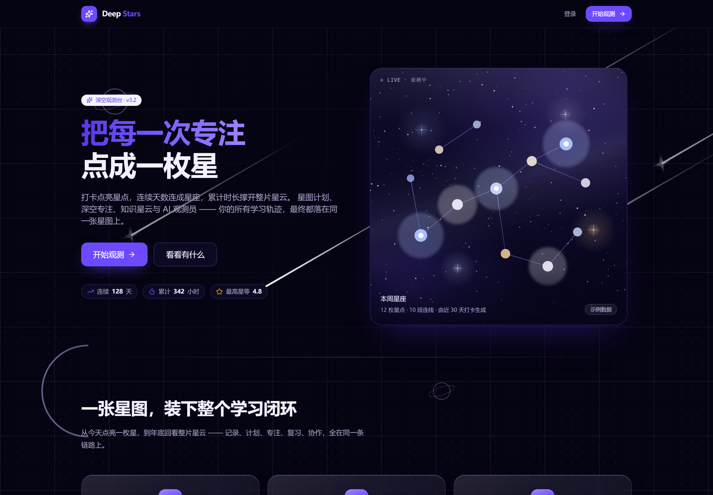

# Deep Stars · 深星

> 把每一次专注，点成一枚星。

深夜星图风格的学习成长平台。打卡点亮星点，连续的日子连成星座，累计的时长撑开整片星云 —— 所有学习轨迹最终都落在同一张星图上。

### 👉 [**点击即用 · 打开观测台**](https://deep-stars.onrender.com)

不用安装任何东西，打开就能注册使用。手机上可以「添加到主屏幕」，之后断网也能继续记录。

> 托管在免费实例上，闲置一段时间后首次打开需要等约一分钟唤醒，属正常现象。



## 它解决什么

学习类应用大多停在「计时器 + 待办清单」这一层，坚持不下去往往不是因为功能不够，而是**看不到积累**。

深星换了个表达方式：每一次打卡就是往星图上放一枚星。星等由当天的专注时长与状态算出，位置由黄金角推演 —— 所以同一份记录每次渲染出的星图完全一致，它是一件可以回看的东西，而不是一串数字。

连续的日子会自动连成星座；断掉一天，链就停在那里，明天从新的位置接着长。

## 快速开始

```bash
pnpm install
pnpm db:push && pnpm dev
```

打开 <http://localhost:3210>，注册一个账号即可开始。

**本地零外部依赖**：默认用 SQLite（`dev.db`），不需要 Docker、不需要数据库服务、不需要任何 API Key。AI 相关功能在没有密钥时会降级为本地规则引擎，功能仍然完整。

## 环境变量

复制 `.env.example` 为 `.env`，至少填这两个：

| 变量 | 必填 | 说明 |
|---|---|---|
| `DATABASE_URL` | ✅ | 本地 `file:./dev.db`；线上填 Neon 的 `postgresql://…` |
| `BETTER_AUTH_SECRET` | ✅ | 会话签名密钥。`openssl rand -base64 32` |
| `DEEP_STARS_SECRET` | ✅ | BYOK 密钥的对称加密密钥。`openssl rand -hex 32`。**设定后不要更换** —— 换了之后所有已保存的 AI 密钥都解不开 |
| `DEEP_STARS_ADMIN_EMAIL` | ⬜ | 引导管理员邮箱。全新部署时数据库里没有管理员，而「第一个」没法由后台自己产生 |
| `BETTER_AUTH_URL` | ⬜ | 部署后填线上地址，本地默认 `http://localhost:3210` |
| `BETTER_AUTH_URL` | ⬜ | 站点地址。**线上可以不填** —— 应用会退回平台注入的 `RENDER_EXTERNAL_HOSTNAME` 并自动补协议头；绑定自定义域名时才需要 |

数据库类型**从连接串前缀自动判断**（`postgres://` / `postgresql://` → PostgreSQL，其余 → SQLite），模型定义一行都不用改。

## 功能

**核心闭环**

- **星座打卡** —— 一次打卡点亮一枚星，星等由专注时长与当天状态算出；位置用黄金角推演，完全可复现
- **星图计划** —— 把长目标拆成任务，按天分组；进度分母会扣掉「已跳过」的任务
- **深空专注** —— 番茄钟。剩余时间由墙上时钟推算，切走标签页也不会走慢；刷新不丢
- **待办** —— 计划之外临时冒出来的碎片
- **统计** —— 26 周热力图与近半年轨迹

**S 档加强**

| 能力 | 说明 |
|---|---|
| PWA 离线 | Service Worker + 离线兜底页；退出登录时清空缓存 |
| 公开分享页 | `/u/<handle>` —— **星图是公开的，笔记不是**。只暴露星图与统计 |
| 年度报告 | `/report/<year>` —— 十二月柱状图、最投入的一天、全年热力图 |
| SRS 复习卡 | SM-2 变体，四档评分，按钮上直接写出"按下去会怎样" |
| AI 主动教练 | 无密钥时降级为本地规则引擎 |
| 数据导出导入 | 全量 JSON 导出；导入是**幂等**的，重复导入不会产生重复 |
| 管理后台 + BYOK | 用户自带 AI Key，AES-256-GCM 加密后落库，明文不留在服务器 |
| 安全加固 | 安全响应头、认证接口限流、导出接口限流 |

## 部署到 Vercel + Neon

1. **建库**：在 [Neon](https://neon.tech) 建一个免费 Postgres，拿到连接串
2. **推 schema**：把连接串放进 `DATABASE_URL`，然后
   ```bash
   pnpm db:push:pg
   ```
   （这条脚本会先从模板渲染出 PostgreSQL 变体的 schema，再推送）
3. **部署**：把仓库导入 Vercel，在环境变量面板填入上表的所有变量
4. 部署完成后把 `BETTER_AUTH_URL` 改成线上地址并重新部署（用 Render 蓝图时**不需要**这一步，地址会自动推导）

> Vercel 上的构建命令走 `pnpm build`，它包含 `prisma generate`。

## 开发

```bash
pnpm check      # 类型检查 + ESLint + 全部单元测试
pnpm test       # 只跑测试
pnpm db:render  # 从模板重新渲染两份 schema
pnpm shoot      # 截图与页面度量（需要本机 Chrome）
```

### 一些刻意的技术选择

- **测试用 Node 内置的 `node:test`**，不引入 Vitest/Jest —— 少一个会 spawn 子进程的依赖。代价是 **`src/lib` 下的纯领域模块必须用相对路径 + `.ts` 扩展名导入**（Node 不读 tsconfig 的 paths），这条由 ESLint 的 `no-restricted-imports` 强制
- **schema 只有一份模板** `prisma/schema.template.prisma`，SQLite 与 PostgreSQL 两个变体由脚本渲染
- **领域逻辑全部是纯函数**（`src/lib/*.ts`），不碰数据库与 React，因此可以被直接测试
- **CSP 里的 `style-src` 与 `script-src` 都带 `'unsafe-inline'`** —— 这不是疏忽，是 Next 的内联引导脚本与 React 的行内样式所必需。详见 `next.config.ts` 文件头的说明与 `tests/csp.test.ts` 的断言，**不要因为"看起来更安全"就改回 `'self'`**

## 许可

[MIT](./LICENSE)
